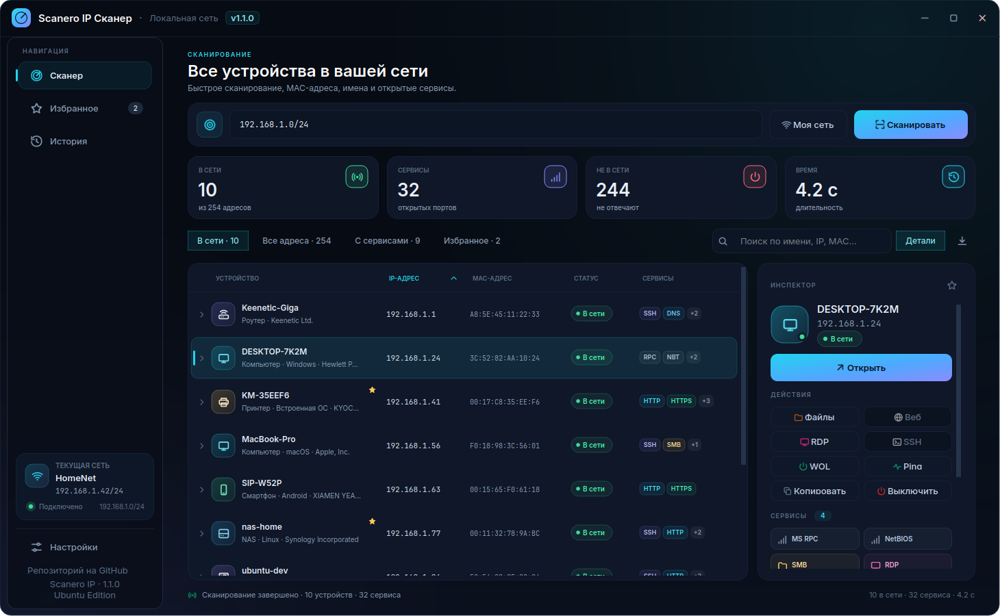
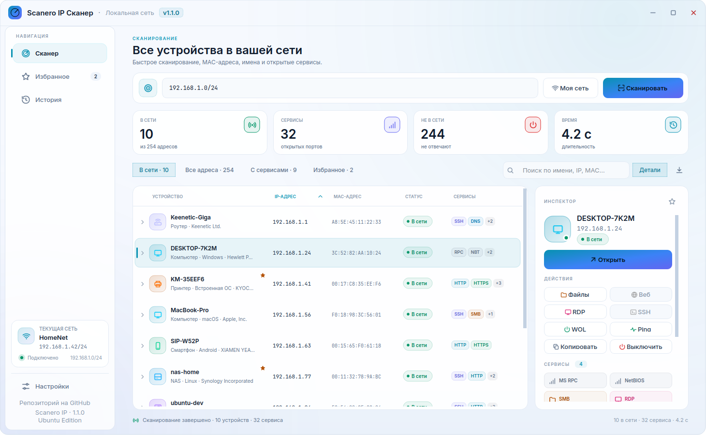
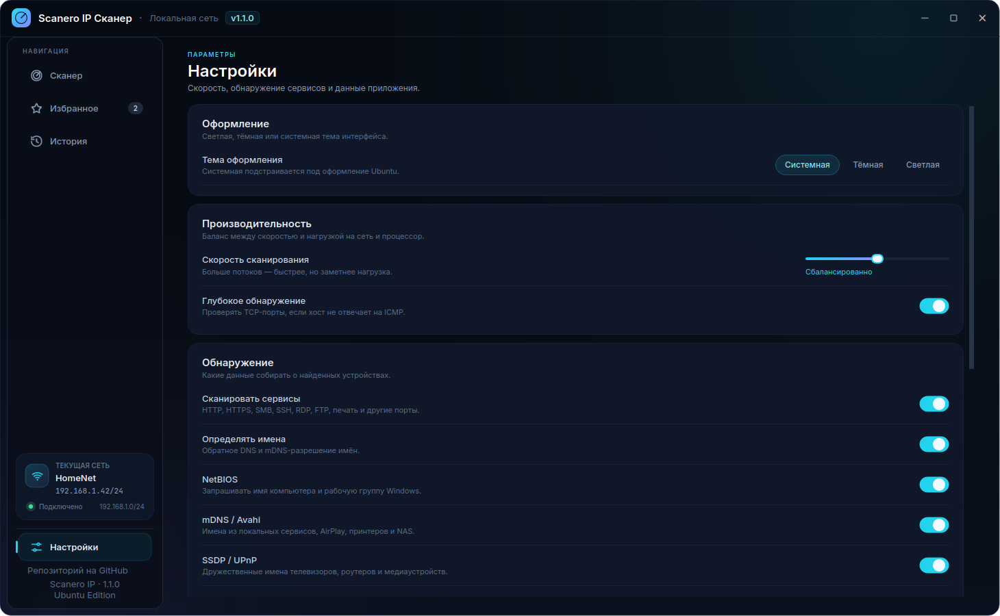
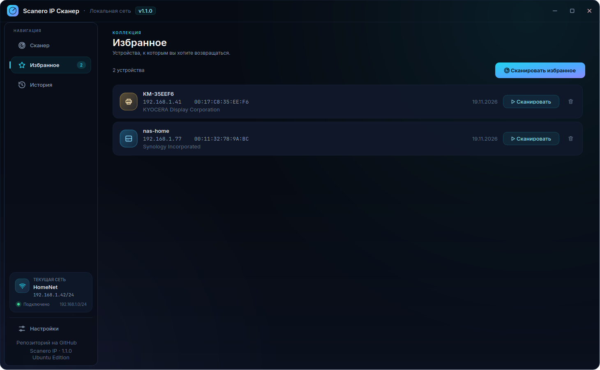

# Scanero IP scanner

**Scanero IP Сканер** — современный сканер локальной сети для Ubuntu: быстрый, красивый и без установки.
По возможностям повторяет Advanced IP Scanner, но нативно работает в Linux и не требует root.

**Версия 1.1.0** · Репозиторий: <https://github.com/kostya4000/Scanero-IP-scanner>



Светлая тема:



## Возможности

- **Быстрое многопоточное сканирование** диапазонов: CIDR (`192.168.1.0/24`), диапазон
  (`192.168.1.10-100`), список адресов, маска `192.168.1.*`, имя интерфейса.
- **Все устройства в сети**: статус, имя, IP, MAC, производитель по базе IEEE OUI.
- **Имена устройств**: NetBIOS, обратный DNS, mDNS/Avahi, SSDP/UPnP, TLS-сертификаты
  и SNMP sysName. Дружественные имена телевизоров, принтеров, NAS и IoT-устройств.
- **Определение ОС и типа**: Windows, Linux, macOS, принтеры, роутеры, NAS, камеры, телефоны.
- **Открытые сервисы**: HTTP, HTTPS, SMB, SSH, RDP, FTP, IPP/LPD, VNC и другие порты.
  Для HTTP/HTTPS подтягиваются `Server` и `<title>`, для SSH/FTP — баннеры.
- **Ресурсы и одно нажатие**: заметная кнопка «Открыть» в инспекторе,
  открытие общих папок, FTP, веб-интерфейсов и RDP одним кликом.
- **Фокус внешних окон**: браузер, файловый менеджер, RDP и терминал
  автоматически поднимаются и получают фокус без зависания интерфейса.
- **Wake-on-LAN** по MAC-адресу.
- **Удалённое выключение/перезагрузка** Windows-компьютеров через Samba `net rpc shutdown`.
- **Ping, traceroute, SSH, Telnet** — запуск в терминале.
- **Избранное** с заметками, MAC и быстрым повторным сканированием.
- **История** последних сканирований со снимками результатов.
- **Экспорт** в CSV (Excel), JSON и красивый HTML-отчёт.
- **Гибкие настройки**: скорость, таймауты, порты, NetBIOS/mDNS, глубокое обнаружение.
- **Современный интерфейс**: тёмная, светлая и системная темы, живой радар,
  панель инспектора, анимации.
- **Ссылки на GitHub** в сайдбаре, настройках и окне «О программе».




## Установка и запуск

### Вариант 1. Просто запустить из папки

Нужен Python 3.10+ и PyQt6:

```bash
sudo apt install python3-pyqt6
./run.sh
```

или через виртуальное окружение:

```bash
python3 -m venv .venv
. .venv/bin/activate
pip install -r requirements.txt
python3 app.py
```

### Вариант 2. Установить в меню приложений

```bash
./install.sh
```

Скрипт скопирует приложение в `~/.local/share/scanero`, добавит ярлык
`Scanero IP Сканер` в меню и команду `scanero` в `~/.local/bin`.

Удалить: `./uninstall.sh` (настройки в `~/.config/scanero` сохраняются).

### Зависимости для отдельных действий

Сканирование работает без них, но для интеграций полезно поставить:

```bash
sudo apt install remmina freerdp2-x11 samba-common-bin gvfs gvfs-backends avahi-utils xdg-utils xdotool
```

- `samba-common-bin` — удалённое выключение Windows (`net rpc shutdown`);
- `remmina` / `freerdp2-x11` — RDP;
- `gvfs-backends` — открытие `smb://` в файловом менеджере;
- `avahi-utils` — mDNS-имена;
- любой терминал (`gnome-terminal`, `xterm`, `konsole`…) — SSH/Ping/Telnet;
- `xdotool` — автоматическое поднятие и фокус новых окон (X11).

Root-права **не нужны**. ICMP использует системный `ping`, а если утилита недоступна —
приложение определяет хосты по TCP и ARP.

## Быстрый старт

1. Запустите `./run.sh`.
2. Проверьте диапазон — кнопка **«Моя сеть»** подставит подсеть текущего интерфейса.
3. Нажмите **«Сканировать»** (или `F5`).
4. Выберите устройство в таблице — справа появятся сведения, сервисы и действия.
5. Раскройте строку (шеврон слева), чтобы увидеть найденные сервисы.
6. Двойной клик открывает основной ресурс; правый клик — полное меню действий.

Фильтры над таблицей: **В сети**, **Все адреса** (включая неответившие), **С сервисами**,
**Избранное**. Поиск ищет по имени, IP, MAC, производителю и сервисам.

### Горячие клавиши

| Клавиши | Действие |
|---|---|
| `F5` | Запустить / остановить сканирование |
| `Ctrl+F` | Поиск |
| `Ctrl+E` | Экспорт CSV |
| `Ctrl+1/2/3` | Сканер / Избранное / История |
| `Ctrl+,` | Настройки |
| `Esc` | Остановить скан, очистить поиск или выделение |

## Командная строка

Тот же движок можно использовать без графики:

```bash
python3 app.py --cli --range 192.168.1.0/24
python3 app.py --cli --interface wlp0s20f3 --json scan.json --html report.html
python3 app.py --cli --range 10.0.0.1-254 --ports 22,80,443,445,3389
```

Опции: `--no-services`, `--no-names`, `--threads`, `--timeout`, `--all`, `--csv`, `--json`, `--html`.

## Как это работает

- **Обнаружение**: ICMP-эхо, затем TCP-проверка популярных портов и ARP-таблица
  (устройства, которые не отвечают на ping, но видны на канальном уровне).
- **Обогащение**: MAC из ARP, производитель из OUI (40 000+ префиксов), NetBIOS-запрос
  (UDP/137), обратный DNS через `getent`, mDNS через `avahi-resolve`.
- **Сервисы**: неблокирующие TCP-подключения к выбранным портам, баннеры SSH/FTP,
  HTTP(S)-заголовки и заголовок страницы.
- **Имена**: параллельно с ping-сканом выполняется mDNS-browse и SSDP/UPnP-обнаружение;
  для оставшихся без имени устройств читается TLS CN и SNMP sysName.
- **Классификация**: по портам, производителю, TTL, именам и баннерам.
- Всё выполняется в фоновом потоке; интерфейс обновляется по мере находок.

## Настройки и данные

Хранятся локально, без телеметрии:

```
~/.config/scanero/settings.json    настройки
~/.config/scanero/favorites.json   избранное
~/.config/scanero/history.json     история (до 20 сканирований)
```

Сбросить настройки можно на странице **Настройки**, избранное и историю — там же
(экспорт/импорт избранного в JSON). Тема выбирается в разделе **Оформление**:
системная, тёмная или светлая.

## Ограничения

- MAC-адреса определяются только у устройств в локальном L2-сегменте (ARP).
- ICMP и часть портов могут быть закрыты фаерволом — такие хосты иногда не видны.
- Удалённое выключение рассчитано на Windows + Samba; для Linux-хостов используйте SSH.
- Radmin на Linux не поддерживается; RDP открывается через Remmina/FreeRDP.
- Приложение не является форком или официальной версией Advanced IP Scanner
  (Famatech); это самостоятельная реализация с похожими функциями.

## Разработка

```
app.py                     точка входа и demo/screenshot-режимы
scanero/core/             сканер, сеть, OUI, модели, экспорт, настройки
scanero/ui/               тема, иконки, виджеты, таблица, страницы, окно
scanero/assets/           шрифты Inter / JetBrains Mono, иконки, база OUI
tools/build_icons.py       перегенерация PNG-иконок (ImageMagick)
tools/make_icon.py         иконка приложения
tests/test_core.py         тесты ядра
```

Проверка:

```bash
python3 -m unittest discover -s tests -v
python3 -m compileall -q app.py scanero
```

Демо-скриншот без реальной сети:

```bash
QT_QPA_PLATFORM=offscreen python3 app.py --demo --size 1460x900 --screenshot preview.png
```

## Лицензии

Код — MIT (см. `LICENSE`).
Шрифты **Inter** и **JetBrains Mono** — SIL Open Font License, тексты в
`scanero/assets/fonts/`. База OUI — публичные данные IEEE. Иконки отрисованы
специально для проекта в стиле Lucide (MIT).
